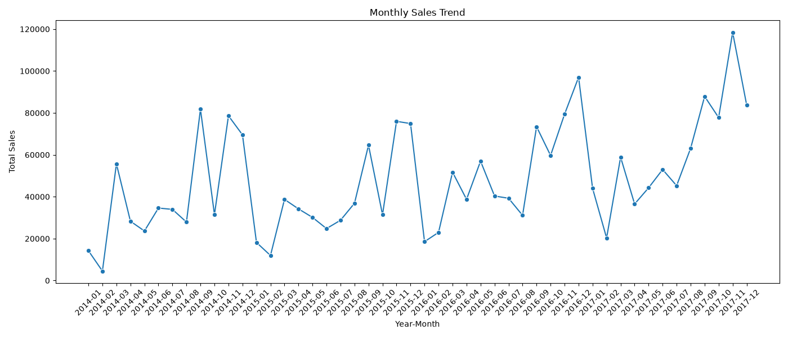
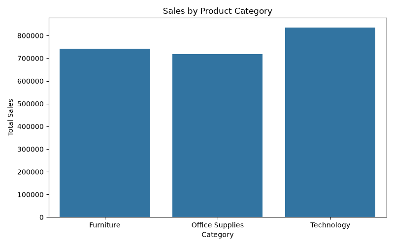
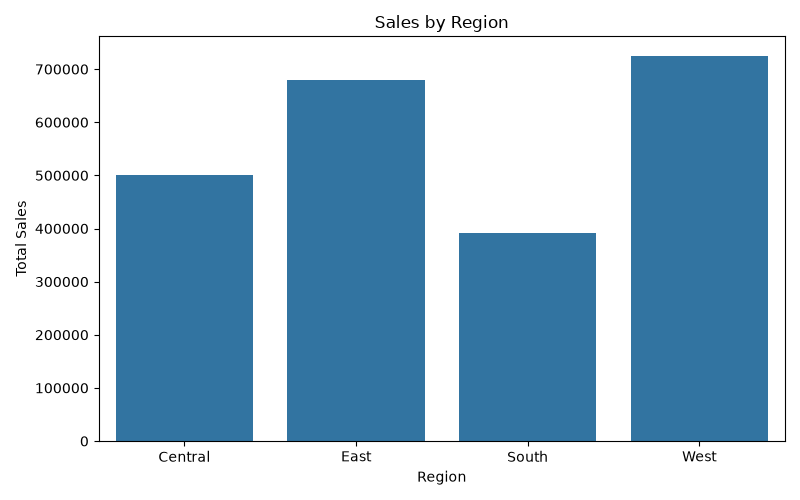
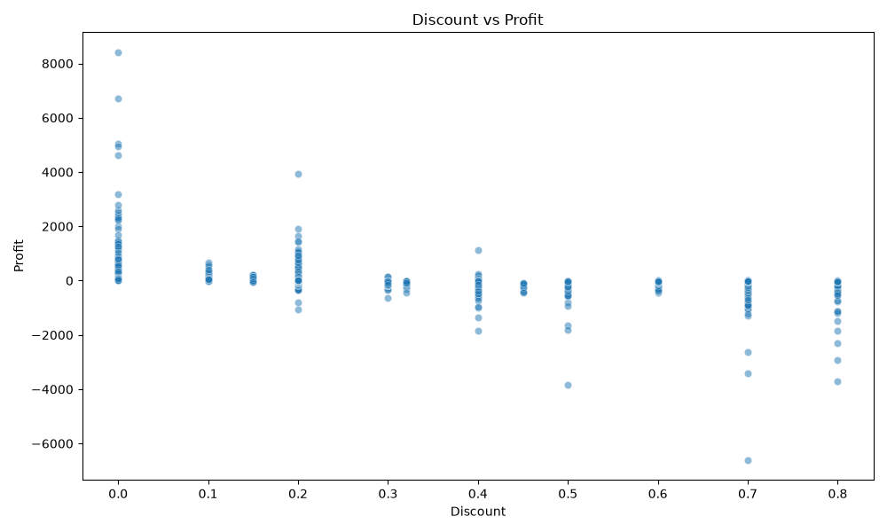

# Superstore Sales Analysis

## Executive Summary

This project analyzes **9,994 Superstore transactions** to identify sales trends, seasonality, category performance, regional performance, customer-segment contribution, and discount sensitivity.

**Total Sales:** $2,297,200.86  
**Total Profit:** $286,397.02

---

## 1. Project Objective

The main objectives of this analysis are:

- Analyze customer purchase volume and monthly sales patterns.
- Identify seasonal sales trends.
- Compare sales and profit across product categories.
- Analyze regional sales and profitability.
- Compare customer segment performance.
- Examine the relationship between discounts and profit.
- Provide actionable business recommendations.

---

## 2. Dataset Information

The dataset contains **9,994 rows and 21 columns**.

Important columns include:

- Order Date
- Ship Date
- Customer Name
- Segment
- Region
- Category
- Sub-Category
- Sales
- Quantity
- Discount
- Profit

### Data Preparation

The following preprocessing steps were performed:

- Checked for missing values.
- No missing values were found.
- Converted `Order Date` into datetime format.
- Created a `Year-Month` column.
- Grouped data by month, category, region, customer segment, and discount.
- Calculated total Sales and Profit for each group.

---

## 3. Monthly Sales Analysis

Monthly sales were calculated using the `Year-Month` column.

- **Highest sales month:** November 2017
- **Sales:** $118,447.82
- **Lowest sales month:** February 2014
- **Sales:** $4,519.89

Sales generally became stronger in the later years, with several high-demand periods occurring between **September and December**.

### Business Insight

The business shows evidence of seasonal demand. Inventory, marketing campaigns, and promotional activities can be planned in advance of high-demand periods.

### Visualization

---

## 4. Product Category Analysis

| Category | Total Sales | Total Profit |
|---|---:|---:|
| Technology | $836,154.03 | $145,454.95 |
| Furniture | $741,999.80 | $18,451.27 |
| Office Supplies | $719,047.03 | $122,490.80 |

### Key Observation

**Technology** is the strongest category by both sales and profit.

Although Furniture has higher sales than Office Supplies, its profit is much lower. This shows that sales revenue alone is not enough to evaluate category performance.

### Visualization

---

## 5. Regional Analysis

| Region | Total Sales | Total Profit |
|---|---:|---:|
| West | $725,457.82 | $108,418.45 |
| East | $678,781.24 | $91,522.78 |
| Central | $501,239.89 | $39,706.36 |
| South | $391,721.91 | $46,749.43 |

### Key Observation

The **West region** has the highest sales and profit.

The **South region** has the lowest sales, indicating an opportunity to improve regional sales performance.

### Visualization

---

## 6. Customer Segment Analysis

| Customer Segment | Total Sales | Total Profit |
|---|---:|---:|
| Consumer | $1,161,401.34 | $134,119.21 |
| Corporate | $706,146.37 | $91,979.13 |
| Home Office | $429,653.15 | $60,298.68 |

### Key Observation

The **Consumer segment** contributes the highest sales and profit.

Corporate customers are the second-largest contributor, while Home Office contributes the lowest sales and profit among the three segments.

### Business Insight

Customer-segment analysis can help the company create targeted marketing, retention, and cross-selling strategies.

---

## 7. Discount Sensitivity Analysis

The analysis examined the relationship between discount levels and profit.

Examples from the analysis:

| Discount | Total Profit |
|---:|---:|
| 0% | $320,987.60 |
| 70% | -$40,075.36 |
| 80% | -$30,539.04 |

### Key Observation

Higher discount levels are associated with weaker profitability. Several high-discount levels generate overall losses.

For example, the **70% discount level resulted in a loss of $40,075.36**.

### Business Insight

Aggressive discounting can increase sales volume but may reduce or eliminate profit. Discount strategies should therefore be carefully controlled.

### Visualization

---

## 8. Executive Takeaways

1. **Technology is the strongest product category**, generating $836,154.03 in sales and $145,454.95 in profit.

2. **West is the strongest region**, generating $725,457.82 in sales and $108,418.45 in profit.

3. **Consumer customers contribute the highest sales and profit**, making this segment an important target for customer retention and marketing.

4. **November 2017 recorded the highest monthly sales** at $118,447.82, while February 2014 recorded the lowest at $4,519.89.

5. **Sales show stronger performance in later years**, with recurring high-demand periods toward the end of the year.

6. **Higher discounts can significantly reduce profitability**, with some high-discount levels producing overall losses.

7. **Sales and profit should be analyzed together**, because a category or region with high sales may not always generate proportionally high profit.

---

## 9. Business Recommendations

Based on the analysis, the following recommendations can be made:

- Prioritize high-performing **Technology products** while monitoring profit margins.
- Prepare inventory and marketing campaigns before strong **September–December** sales periods.
- Develop region-specific strategies to improve performance, especially in the **South region**.
- Focus customer retention and cross-selling efforts on the **Consumer segment**.
- Set reasonable discount limits to protect profit margins.
- Evaluate promotions based on **profitability**, not only sales growth.
- Review products with high discounts and negative profits to identify pricing or promotion issues.

---

## 10. Conclusion

The Superstore Sales Analysis provides useful insights into sales trends, product categories, regions, customer segments, and discount sensitivity.

The analysis shows that **Technology, West, and Consumer** are the strongest-performing areas. Sales also show seasonal variation, with stronger performance during several year-end periods.

The discount analysis highlights an important business risk: **aggressive discounts can increase sales but negatively affect profitability**.

Overall, the business should focus on **profitable growth, seasonal planning, targeted customer and regional strategies, and disciplined discount management**.

---

## 11. Visualizations

The following visualizations were created using Python:

- `monthly_sales.png` — Monthly Sales Trend
- `category_sales.png` — Sales by Product Category
- `region_sales.png` — Sales by Region
- `discount_vs_profit.png` — Discount vs Profit